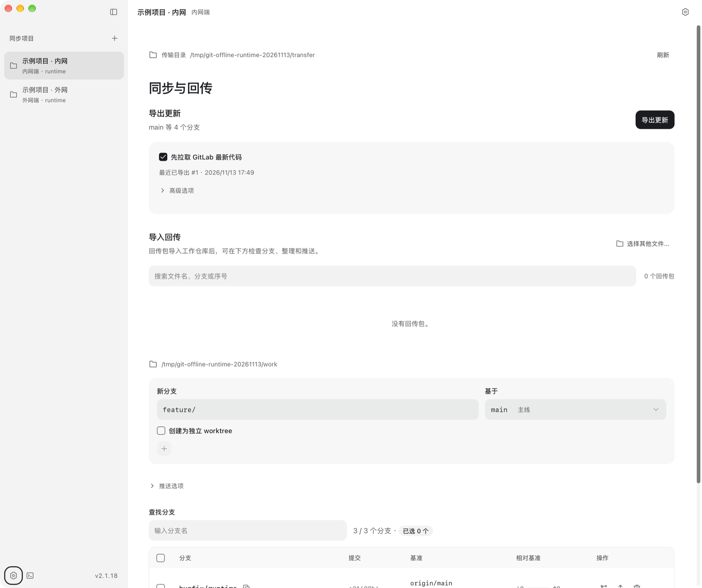
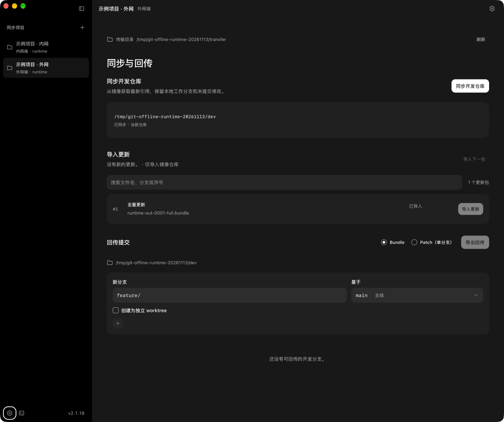
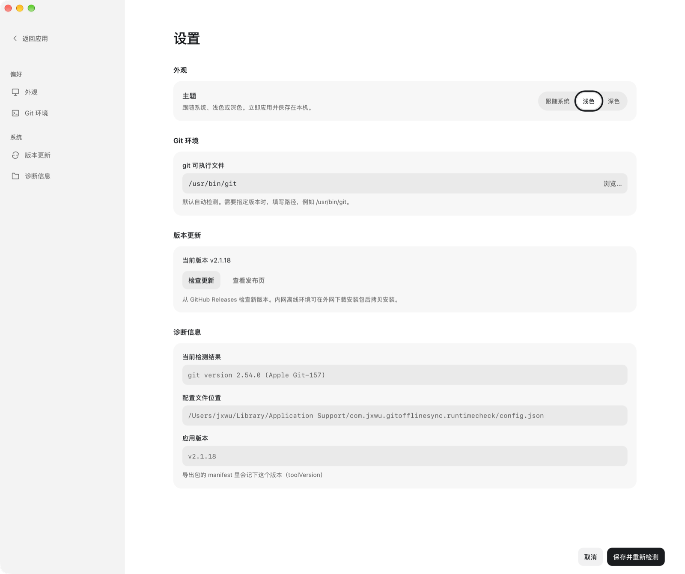

# Git 离线同步（git-offline-sync）

通过 U 盘等移动介质，在内网 GitLab 与外网开发机之间传递代码更新和开发提交。应用使用 Git Bundle 或 Patch 保存变更，两端无需直接联网。

支持 Windows 和 macOS。当前版本：**2.1.19**。

[下载安装包](https://github.com/laplacesc/git-offline-sync/releases/latest) · [本次更新](docs/releases/v2.1.19.md) · [历史版本](https://github.com/laplacesc/git-offline-sync/releases)

## 应用截图

以下截图来自 v2.1.18 的 macOS 原生 Tauri 应用，使用本地示例仓库。

**内网端 · 浅色主题**：从 GitLab 准备镜像、导出更新，并接收外网回传的提交。



**外网端 · 深色主题**：导入更新包、同步开发仓库，选择分支导出 Bundle 或单分支 Patch。



<details>
<summary>查看应用设置</summary>

主题可选择跟随系统、浅色或深色。Git 不在 PATH 时，可在这里指定可执行文件并重新检测。



</details>

## 安装

两端都需要 **Git ≥ 2.36**。安装包从 [GitHub Releases](https://github.com/laplacesc/git-offline-sync/releases/latest) 下载后，可复制到离线机器安装。

| 使用环境 | 安装包 | 说明 |
| --- | --- | --- |
| Windows x64，首次离线安装 | `*-setup-with-webview2.exe` | 包含 WebView2 离线安装程序 |
| Windows x64，已有 WebView2 | `*-setup-no-webview2.exe` | 体积较小，也用于应用内更新 |
| macOS Intel / Apple Silicon | `*_universal.dmg` | Universal 安装包，适用于两种架构 |

macOS 未签名安装包首次打开时，可尝试右键应用选择“打开”；如果系统仍拦截，请在“系统设置 → 隐私与安全性”中检查提示。

安装后打开应用设置，确认 Git 检测成功。离线运行所需的字体、图标、样式和脚本随应用提供，不依赖在线 CDN。访问 GitLab、下载应用更新仍需要相应网络连接。

## 使用

### 1. 配置内网端与外网端

在侧栏新建同步配置，选择这台电脑的角色。两端使用相同的包名前缀、主线分支和发布分支设置；配置名称只用于本机识别。

| 配置项 | 内网端 | 外网端 |
| --- | --- | --- |
| 传输目录 | 存放导出更新和待导入回传包 | 存放待导入更新和导出回传包 |
| 镜像仓库目录 | 从 GitLab 建立的裸仓库 | 接收内网更新的裸仓库 |
| 工作仓库 / 开发仓库 | 接收回传、处理分支并推送的工作仓库 | 实际编写、提交代码的一个或多个开发仓库 |
| GitLab 地址 | 建立镜像和获取上游更新 | 无需填写 |

**镜像仓库与工作仓库、开发仓库必须使用不同目录。** 两台电脑上的目录路径可以不同。传输目录可以直接指向移动介质，也可以使用本地目录后手动复制文件。

### 2. 将内网更新带到外网

1. 在内网端点击“建立镜像”，从 GitLab 准备代码。
2. 点击“导出更新”。首次生成全量包，后续可生成增量包；需要重新准备外网镜像时，可在高级选项中选择“强制全量”。
3. 将生成的 Bundle **连同对应清单文件**复制到外网传输目录。
4. 在外网端刷新传输目录，点击“导入下一包”。此操作只更新外网镜像。
5. 点击“同步开发仓库”，从镜像获取更新。尚未创建的开发仓库会从镜像克隆；已有仓库保留本地工作分支、暂存区和未提交修改。

增量包需要按序导入。缺少中间包时，应补齐包，或导入较新的全量包。跳过序号导入全量包前，应用会列出引用变化；镜像中包外的分支和标签可能被移除，请核对后确认。

### 3. 将外网提交带回内网

1. 在外网开发仓库完成开发并提交。
2. 在“回传提交”中选择分支和格式：Bundle 可选择多个分支，Patch 只支持单分支。
3. 点击“导出回传”，将生成的包及清单复制到内网传输目录。传输 Patch 时保留完整目录与清单，不要只复制其中的补丁文件。
4. 在内网端点击“导入回传”，检查导入分支，按需执行 Rebase。
5. 推送前核对源提交、目标分支、远程地址与远程旧提交，再确认推送。

Patch 应用要求对应工作区干净。发生冲突时，在对应工作树解决后继续，也可以中止恢复。重复导入不会覆盖之后的本地修改。

### 查看记录与处理未完成操作

点击“查看记录”可展开命令日志，支持复制、清空、调整高度和暂停跟随。收起记录期间，新的命令输出仍会保留。

存在未完成的 Patch 或 Rebase 时，按应用提示继续或中止。停止、取消或超时不等于回滚，应检查实际 Git 状态后再进行下一步。

## 安全边界

- **只导入可信来源的包。** 应用会校验清单、仓库身份、序号、引用和 Git 对象；这些校验不等同于数字签名认证。
- 外网镜像禁止推送，外网开发仓库的 push 地址会被禁用；推送只在内网工作仓库执行。
- 推送确认绑定源提交、目标引用、远程地址和远程旧提交，并使用显式 lease。非快进更新需要额外确认。
- 保留未提交修改保护、引用事务、并发锁和冲突恢复。不要手动删除恢复日志、状态备份、导出暂存目录或锁文件来绕过保护。
- 日志会隐藏常见 URL 凭据和令牌参数，但不会检测所有秘密；分享日志前请自行检查。

## 开发与验证

技术栈为 **Rust + Tauri v2 + React + TypeScript + shadcn/ui**，使用 Vite 和 Tailwind CSS v4。Rust 核心负责 Git 执行、包校验、持久化、锁、取消与恢复。项目约定见 [AGENTS.md](AGENTS.md)。

需要 Node ≥ 22.13、pnpm 11.5.0、Rust stable，以及对应平台的 [Tauri v2 构建环境](https://v2.tauri.app/start/prerequisites/)。CI 使用 Rust 1.98.1。

```bash
pnpm install --frozen-lockfile
pnpm tauri dev
```

提交前按改动范围执行：

```bash
pnpm test
pnpm build
pnpm check:version
cargo test --manifest-path src-tauri/Cargo.toml --locked
cargo fmt --manifest-path src-tauri/Cargo.toml --all -- --check
cargo clippy --manifest-path src-tauri/Cargo.toml --locked --all-targets -- -D warnings
```

模拟 IPC 的浏览器测试不能替代 Windows/macOS 原生应用验收。

## 打包与发布

本地打包：

```bash
pnpm tauri build
```

发布前同步更新 `package.json`、`src-tauri/Cargo.toml`、`src-tauri/Cargo.lock` 和 `src-tauri/tauri.conf.json` 的应用版本，并创建 `docs/releases/v<版本>.md`。

推送 `v<版本>` 标签后，[GitHub Actions](.github/workflows/build.yml) 会在 Windows 和 macOS 上执行测试，再构建两种 Windows 安装包和 macOS Universal 安装包。带 `-` 的版本标签作为预发布。

发布流程校验安装包、更新归档、签名、发布说明和下载文件的 SHA-256，全部通过后才公开 Release；上传或校验失败时保留草稿供重试。应用内更新使用 Release 中的 `latest.json`。
